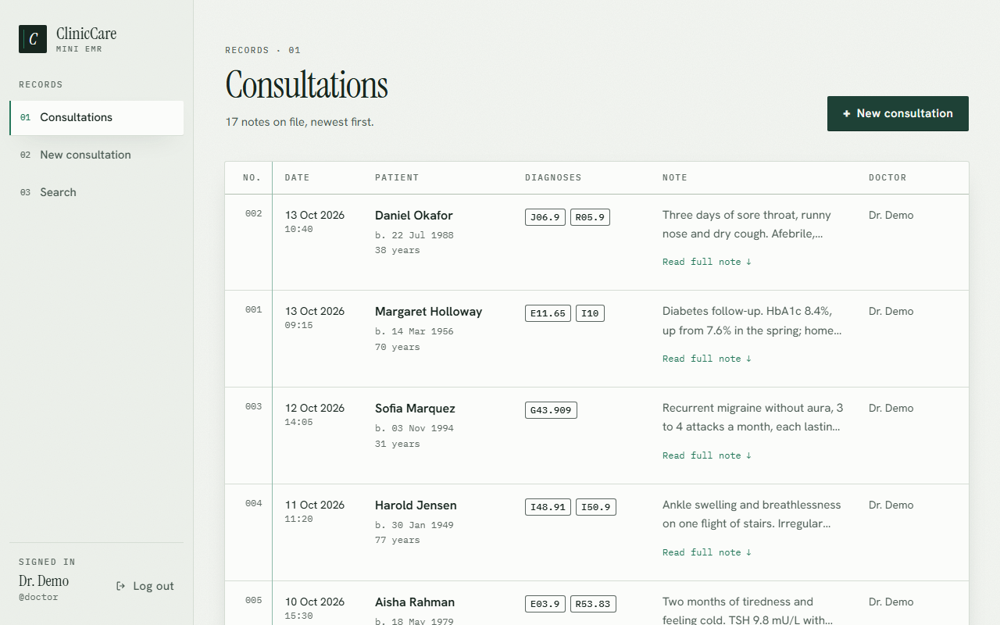
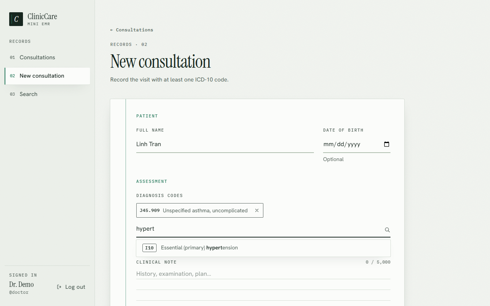
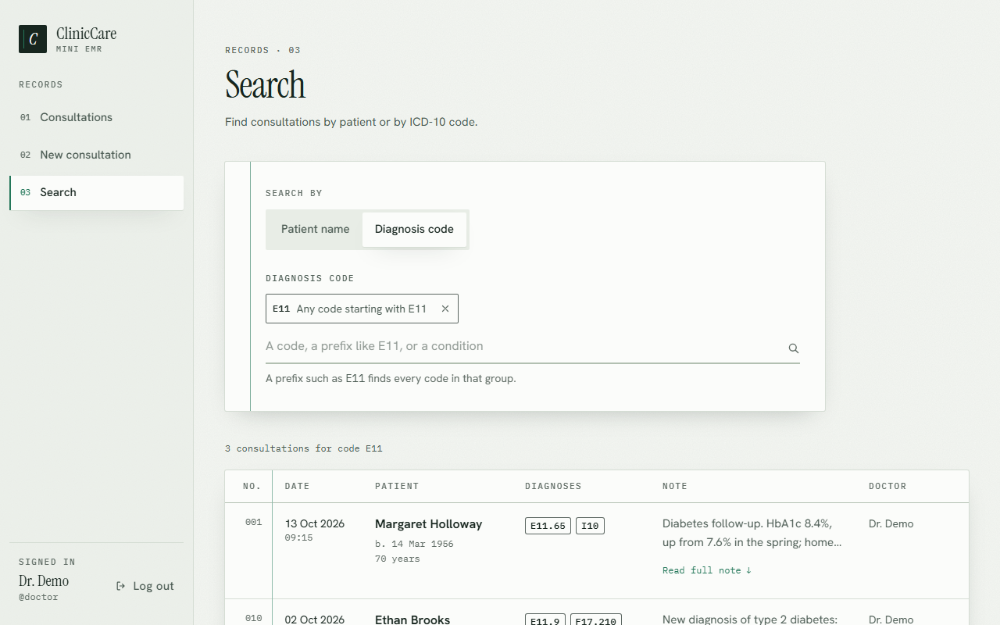
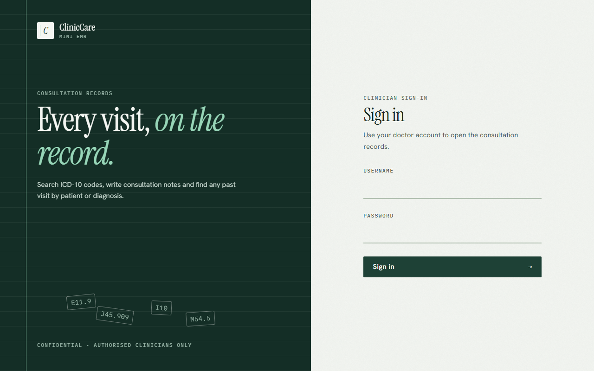

# ClinicCare Mini EMR

A small, secure EMR tool for doctors. It lets a doctor:

1. Search 100 real ICD-10-CM diagnosis codes.
2. Record a consultation note with one or more of those codes.
3. List past consultation notes, newest first.
4. Search notes by patient name or by diagnosis code (exact, or a prefix such as `E11`).

Built for a technical assignment ([brief](docs/ASSIGNMENT.md)). The commit history follows the development steps, one commit per task.

| Consultations list | New consultation |
|---|---|
|  |  |
| **Search by diagnosis code** | **Sign in** |
|  |  |

On a phone the list becomes cards and the sidebar a menu sheet ([screenshot](docs/screenshots/phone.png)).

## Stack

| Part | Choice |
|---|---|
| Backend | FastAPI, SQLAlchemy 2, Pydantic v2, SQLite |
| Frontend | Nuxt 3 (SSR), TypeScript, Tailwind CSS |
| Auth | JWT, kept in an HttpOnly cookie by the Nuxt server (backend-for-frontend) |
| Tests | pytest, Vitest, Playwright (end to end against the real backend) |
| Run | Local dev servers, or Docker Compose |

## Architecture

```
Browser ──same origin──▶ Nuxt server ──────────────▶ FastAPI ──▶ SQLite
           SSR pages      ├─ renders the pages         /auth, /diagnosis,
           /api/** calls  └─ /api BFF: adds the        /consultation
           HttpOnly cookie     Bearer token from
                               the cookie
```

- The browser only talks to the Nuxt server. Page scripts never see the JWT.
- The Nuxt server's `/api` routes (`frontend/server/`) are a backend-for-frontend (BFF). They forward an exact list of API routes to FastAPI and add `Authorization: Bearer <token>` from the `cc_token` cookie.
- FastAPI is a plain Bearer-token API. Swagger at `/docs` works against it directly.

### Sign-in flow

1. The login form posts to `/api/auth/login` on the Nuxt server.
2. The Nuxt server signs in with FastAPI (`POST /auth/login`), sets the `cc_token` cookie (`HttpOnly; SameSite=Lax; Path=/`), and returns the doctor.
3. Every later `/api/**` call goes out from the Nuxt server with the Bearer token from that cookie.
4. On a 401 (expired or invalid token), the Nuxt server clears the cookie and the page goes back to `/login?redirect=…`.
5. Logout posts to `/api/auth/logout`, which deletes the cookie.

Each `/api` route refuses a request whose `Origin` is another site. Together with `SameSite=Lax`, this protects the cookie against cross-site request forgery.

### Repository layout

```
backend/    FastAPI app (app/), seed SQL (sql/), pytest suite (tests/)
frontend/   Nuxt app: pages/, components/, composables/, server/ (BFF),
            tests/ (Vitest), e2e/ (Playwright)
docs/       Assignment brief, screenshots
docker-compose.yml, backend/Dockerfile, frontend/Dockerfile   Docker setup
```

## Run it locally

Requirements: Python 3.11 or newer, Node 22 or newer.

**1. Backend** (port 8000):

```bash
cd backend
python -m venv .venv
.venv/Scripts/activate          # Windows; on macOS/Linux: source .venv/bin/activate
pip install -r requirements-dev.txt
cp .env.example .env            # then set JWT_SECRET (see the comment in the file)
uvicorn app.main:app --reload
```

On first start the API creates the SQLite database in `backend/data/`, loads the 100 ICD-10 codes, creates the demo doctor and gives it 17 sample consultations (fictional patients) to explore.

**2. Frontend** (port 3000), in a second terminal:

```bash
cd frontend
npm install
cp .env.example .env            # NUXT_API_BASE=http://localhost:8000
npm run dev
```

Open http://localhost:3000 and sign in as the demo doctor: **`doctor` / `doctor123`**.

The first visit to each page in `npm run dev` can reload once while Vite prepares its dependencies; anything typed before that reload is lost. It only happens on a cold dev server, never in the production build or Docker.

## Run it with Docker

```bash
cp backend/.env.example backend/.env   # skip if you already have it; set JWT_SECRET
docker compose up --build
```

Compose reads the backend's settings from the same `backend/.env` as a local run. Open http://localhost:3000. Only the frontend publishes a port. The API runs on the compose network, and the Nuxt server calls it at `http://backend:8000`. The SQLite file lives in the `db-data` volume, so data survives `docker compose restart`. To use Swagger, uncomment the localhost-only port line in `docker-compose.yml`.

## Configuration

| Variable | Where | Default | Purpose |
|---|---|---|---|
| `JWT_SECRET` | backend | random per start | Signs access tokens. Set it, or every restart signs everyone out. At least 32 characters. |
| `ACCESS_TOKEN_EXPIRE_MINUTES` | backend | `60` | Token lifetime. |
| `DATABASE_URL` | backend | `sqlite:///./data/cliniccare.db` | Relative SQLite paths resolve from `backend/`. |
| `CORS_ORIGINS` | backend | `http://localhost:3000` | Only for browser pages on another origin calling the API directly. The app doesn't need it. |
| `DEMO_DOCTOR_USERNAME` / `_PASSWORD` / `_FULL_NAME` | backend | `doctor` / `doctor123` / `Dr. Demo` | Demo account created at startup. Empty username skips it. |
| `DEMO_CONSULTATIONS` | backend | `true` | Adds 17 sample consultations for the demo doctor while the database has none. |
| `NUXT_API_BASE` | frontend | `http://localhost:8000` | FastAPI's URL as the Nuxt server sees it. |
| `NUXT_COOKIE_SECURE` | frontend | `false` | Marks the token cookie `Secure`. Turn on behind HTTPS. |

## API

Interactive docs: http://localhost:8000/docs. Every route except `/health` and `/auth/login` needs `Authorization: Bearer <token>`.

| Method and path | Purpose |
|---|---|
| `GET /health` | Liveness check. |
| `POST /auth/login` | `{username, password}` → `{access_token, token_type}`. |
| `GET /auth/me` | The signed-in doctor. |
| `GET /diagnosis?search=&limit=` | Codes whose code starts with, or whose description contains, `search` (case-insensitive). Code matches rank first. `limit` 1–100, default 20. |
| `POST /consultation` | Save a note: `patient_name`, optional `patient_dob`, `notes`, `diagnosis_codes` (1–20 unique codes). 201 on success, 422 for invalid input, 400 for a well-formed but unknown code. |
| `GET /consultation?patient=&diagnosis=&skip=&limit=` | Notes, newest first, as `{items, total}`. `patient` matches part of the name; `diagnosis` is an exact code or a prefix such as `E11`. |
| `GET /consultation/{id}` | One note; 404 if missing. |

Errors always come back as `{"detail": ...}`. Unexpected errors are logged on the server and return a generic 500.

## Tests and checks

| Check | Command | What it covers |
|---|---|---|
| Backend | `cd backend && python -m pytest` | API, validation, auth, search, seeding (in-memory SQLite). Plus `ruff check .` and `pyright`. |
| Frontend unit | `cd frontend && npm run test` | Vitest: DiagnosisPicker, ConsultationTable, useAuth, utilities. |
| End to end | `cd frontend && npm run test:e2e` | Playwright on desktop, tablet and phone. It starts the real FastAPI backend on a fresh SQLite file and the production Nuxt build. Nothing is mocked. |

The first e2e run needs a browser: `npx playwright install chromium`.

To run the same suite against an app that is already up, such as the Docker stack, point it there. Publish the API on a localhost port first (see the commented `ports` line in `docker-compose.yml`), so the tests can create their data:

```bash
E2E_BASE_URL=http://localhost:3000 E2E_API_URL=http://127.0.0.1:8000 E2E_DOCTOR_FULL_NAME="Dr. Demo" npm run test:e2e
```

The one test that edits the SQLite file directly is skipped in that mode.

## Design decisions and trade-offs

- **SQLite.** No server to run, one file, enough for one clinic's demo data. SQLAlchemy keeps a move to Postgres small.
- **`create_all` instead of Alembic.** The schema is created at startup, which keeps the demo simple. A real deployment needs migrations.
- **A BFF instead of a token in JavaScript.** The token sits in an HttpOnly cookie that only the Nuxt server reads, so a script injected into the page cannot read it. The alternative, letting FastAPI set the cookie, needs the frontend and the API on one site. It would also hide the session from server-side rendering.
- **What the BFF costs.** Each API call takes one extra hop through the Nuxt server, and cookie auth needs CSRF guards (`SameSite=Lax` and the `Origin` check). Logout only deletes the cookie: the JWT itself stays valid until it expires, because the API keeps no session list.
- **Times in UTC.** The API stores and returns every timestamp in UTC (`…Z`). The browser shows it in the viewer's own time zone. The sample consultations are dated in clinic hours for UTC+7, so a viewer elsewhere sees them shifted.
- **No `Secure` flag by default.** The app runs over plain http locally and in Docker. `NUXT_COOKIE_SECURE=true` turns it on behind HTTPS.
- **Known advisories.** `npm audit` reports issues in Nuxt 3's dev and build toolchain. The only fix npm offers is Nuxt 4, which the brief rules out. None of them ship in the production server.

## Future work

This is a local demo. A production version would need:

- **Sessions:** HTTPS with HSTS and a `Secure` cookie; CSRF tokens on top of `SameSite` and the `Origin` check; short-lived access tokens with rotating refresh tokens or server-side sessions, so logout and revocation take effect at once; login rate limiting, lockout and MFA; `JWT_SECRET` from a secret manager; no seeded demo doctor.
- **Authorization and audit:** scope notes by doctor, clinic or role (today every doctor sees every note); an audit log of who viewed or changed which patient record, and when.
- **Data:** Postgres; Alembic migrations; encryption at rest; automated backups with tested restores.
- **Operations:** security headers (CSP, `X-Content-Type-Options`, `frame-ancestors`); logs without patient data or tokens; monitoring and alerts; no CORS on the API; Swagger turned off or protected; regular dependency updates.
